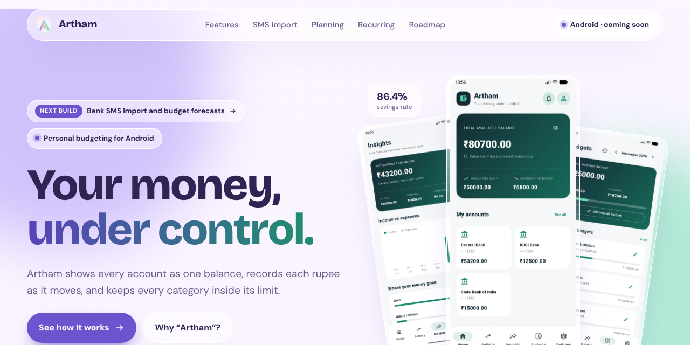

<h1 align="center">Artham · അർത്ഥം</h1>

<p align="center">
  Website for <strong>Artham</strong>, a personal budgeting app for Android.<br>
  One page, glassmorphism, plain HTML and CSS.
</p>

<p align="center">
  
</p>

## About

Artham shows every account as one balance, records each rupee as it moves, and keeps every category inside its limit. The name is Malayalam for *meaning*.

This repository holds the landing page. It showcases the app's Home, Activity, Insights and Budgets screens, with sections for user-initiated bank/UPI SMS paste-and-share import, custom categories, transaction date and time, budget planning and forecasts, recurring transactions, offline merchant recognition and spending insights, CSV/JSON export, local backup history and the roadmap. The page uses light and dark themes based on the visitor's device setting.

The app itself lives in [vishnuwiz/artham](https://github.com/vishnuwiz/artham). The content sections are written from that repository's README and `CHANGELOG.md`.

## Structure

```
index.html      the whole page, styles and a little script inline
img/            app screenshots (WebP, 640×1422), the app icon and the social preview
```

## Run it locally

There is no build step. Open `index.html` in a browser, or serve the folder:

```sh
python3 -m http.server 8000
```

## Publish with GitHub Pages

1. Open **Settings → Pages**.
2. Under **Build and deployment**, choose **Deploy from a branch**, pick `main` and `/ (root)`, then save.
3. After a minute the site is live at `https://<your-username>.github.io/<repository>/`.

## Keeping it up to date

When the app repository gets a new README or changelog entry, update these sections in `index.html`:

- **Feature details:** keep the Home, Activity, Insights and Budgets descriptions aligned with implemented app behaviour.
- **Custom categories and transaction date/time:** keep the feature tiles and examples current.
- **SMS import and privacy:** describe only user-initiated paste/share import; do not imply inbox monitoring or automatic SMS intake.
- **Local-first and backups:** keep CSV/JSON export, backup history, restore, retention and encryption notes accurate.
- **What's new:** add the latest Added and Changed items from the app changelog, and refresh the verification note from actual test/device results.
- **Roadmap:** move implemented features out of Planned and update the status labels.
- **Screenshots:** replace files in `img/` using the same names and keep the 9:20 ratio. Use current app screens when available.

## Other things to edit

- **Download button.** The nav and the final section link to Firebase App Distribution for the Android beta. Replace that URL with the Play Store listing when a public release is available.
- **GitHub links.** The "Built in the open" section links to the app repository, its changelog and its issues page.
- **Colours and fonts.** Every colour is a CSS variable at the top of the `<style>` block, with a dark set and a light set.
- **Share preview.** `img/social-preview.png` is also set as the Open Graph image. Upload it under **Settings → General → Social preview** too.

Fonts (Bricolage Grotesque, DM Sans and Noto Sans Malayalam) load from Google Fonts.

## Licence

The website code is released under the [MIT licence](LICENSE). The Artham name, logo and app screenshots are not covered by it.
