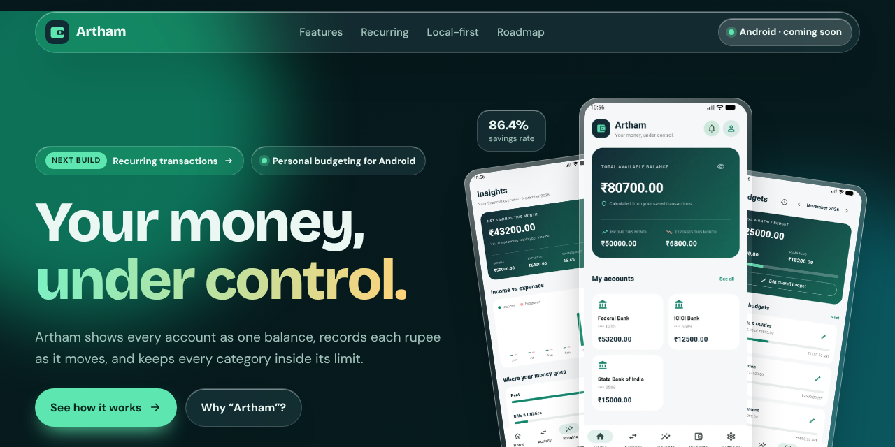

<h1 align="center">Artham · അർത്ഥം</h1>

<p align="center">
  Website for <strong>Artham</strong>, a personal budgeting app for Android.<br>
  One page, glassmorphism, plain HTML and CSS.
</p>

<p align="center">
  
</p>

## About

Artham shows every account as one balance, records each rupee as it moves, and keeps every category inside its limit. The name is Malayalam for *meaning*.

This repository holds the landing page. It shows the app's Home, Activity, Insights and Budgets screens, with sections for recurring transactions, the local-first design, the latest changelog entries and the roadmap. Light and dark themes follow the visitor's device setting.

## Structure

```
site/
  index.html        the whole page, styles inline, no JavaScript
  img/              app screenshots (WebP, 640×1422) and the social preview
.github/
  workflows/pages.yml   deploys site/ to GitHub Pages on every push to main
  dependabot.yml        keeps the workflow actions up to date
  ISSUE_TEMPLATE/       bug report and suggestion forms
  PULL_REQUEST_TEMPLATE.md
```

## Run it locally

There is no build step. Open `site/index.html` in a browser, or serve the folder:

```sh
python3 -m http.server 8000 --directory site
```

## Publish with GitHub Pages

1. Push this repository to GitHub with `main` as the default branch.
2. Open **Settings → Pages** and set **Source** to **GitHub Actions**.
3. The **Deploy to GitHub Pages** workflow runs on every push to `main`. When it finishes, the site is live at `https://<your-username>.github.io/<repository>/`.

For a custom domain, add it under **Settings → Pages → Custom domain**.

## Things to edit

- **Download button.** The nav and the last section show "Android · coming soon". Search `site/index.html` for `coming soon` and replace those pills with a link to the Play Store or APK page.
- **Screenshots.** Replace the files in `site/img/` using the same names and keep the 9:20 ratio.
- **GitHub links.** The "Built in the open" section links to the app repository, its changelog and its issues page. Change them if the repository moves.
- **App content.** The recurring transactions, local-first, changelog and roadmap sections are written from the app repository's README and `CHANGELOG.md`. Update them when a release is confirmed.
- **Colours and fonts.** Every colour is a CSS variable at the top of the `<style>` block, with a dark set and a light set.
- **Share preview.** Upload `site/img/social-preview.png` under **Settings → General → Social preview**. To show it on other sites as well, add `<meta property="og:image" content="https://<your-site>/img/social-preview.png">` to the `<head>`.

Fonts (Bricolage Grotesque, DM Sans and Noto Sans Malayalam) load from Google Fonts.

## Licence

The website code is released under the [MIT licence](LICENSE). The Artham name, logo and app screenshots are not covered by it.
